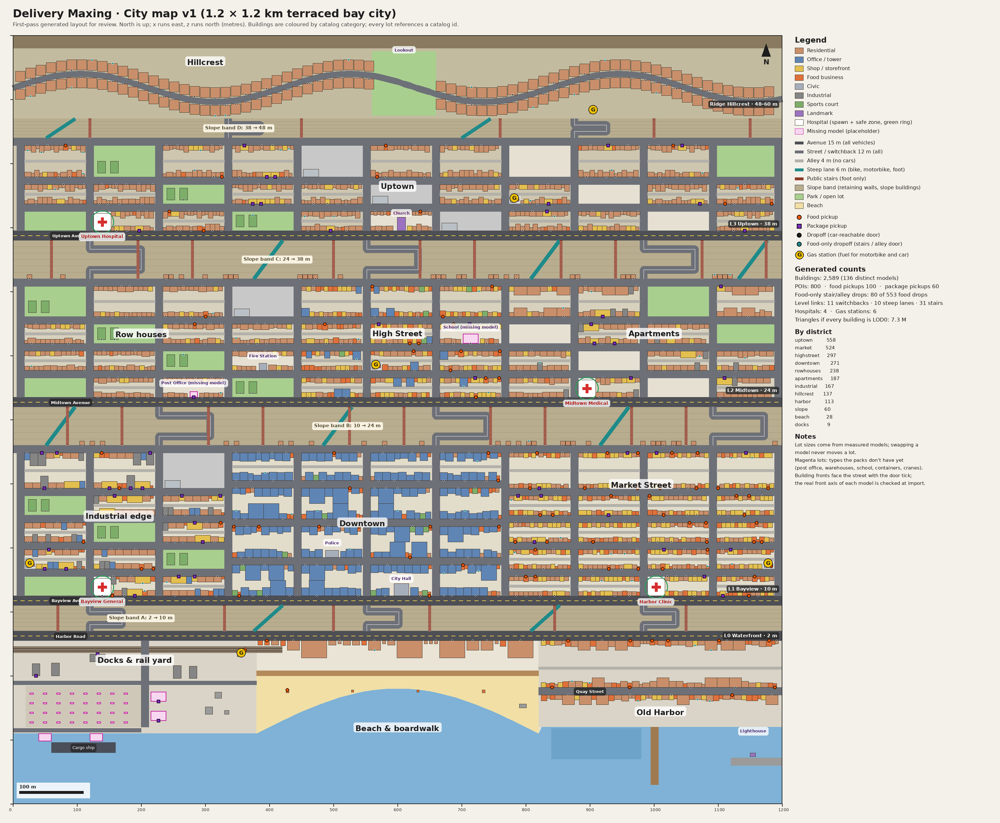

# Delivery Maxing — City Map Design (v1)

- **Date:** 2026-10-14
- **Status:** Approved by the owner on 2026-10-14
- **Parent spec:** `2026-10-12-delivery-maxing-design.md` (revised 2026-10-14 for the redesign: no HUB, point-to-point orders, vehicles, phone, no parkour)
- **Map image:** `img/city-map-topdown.png`
- **Machine-readable catalog:** `map/catalog.json`
- **Prototype scripts that produced the image and the numbers below:** `city-map-prototype/` (throwaway; the real generator is built in the city sub-project)

## 1. Goals and constraints

| Goal | How the map serves it |
|---|---|
| Getting around the city is the fun | A dense, hilly bay city: wall-to-wall blocks, four levels joined by switchbacks, steep lanes and stairs, alleys for small vehicles. |
| Better vehicles earn more | Every package stop is reachable by car within 30 m; only a few food drops are alley- or stair-only. Small vehicles get shortcuts, never a monopoly on pay. |
| Fits the owner's asset library | Layout, lot sizes and order text come from the measured Megatropolis and Tropical City packs (931 `.glb`). Nothing is renamed. |
| Real city logic | Bakeries and cafés on shopping streets, warehouses and factories at the docks, houses on the ridge, hospitals on main roads. |
| 60 fps in the browser | ~200 merged blocks, collider paging and far-LOD boxes, following the SP2 streaming model. |

Decisions this document relies on (from the parent spec): no HUB; orders go pickup → dropoff (food or package); vehicles walk/skateboard/bicycle/motorbike/car with slots 1/1/2/3/5, package limits —/—/—/50/150 kg and top speeds 8/12/16/22/28 m/s; every delivery ends on foot at the door; hospitals are the only spawn points and safe zones; fuel is bought at gas stations with Coins; parkour props (wall-runs, zip lines, jump pads, rails, boost orbs) are gone; sprint, jump, crouch-slide and a low mantle (≤ 1.2 m) remain.

## 2. City structure

A Western bay city, **1.2 × 1.2 km**, that climbs north from the water in terraces. Coordinates: x runs east 0–1,200 m, z runs north 0–1,200 m, y is height.

| Level | Name | Ground height | z range | Districts (west → east) |
|---|---|---|---|---|
| L0 | Waterfront | 2 m | shoreline – 270 | Docks & rail yard · Beach & boardwalk · Old Harbor |
| L1 | Bayview | 10 m | 310 – 560 | Industrial edge · Downtown · Market Street |
| L2 | Midtown | 24 m | 620 – 820 | Row houses · High Street · Apartments |
| L3 | Uptown | 38 m | 880 – 1,040 | Uptown (townhouses, church, small shops) |
| Ridge | Hillcrest | 48 – 60 m | 1,070 – 1,180 | Detached houses along winding Hillcrest Drive, a lookout park |

- **Shoreline:** a straight quay at the docks (z = 110), a crescent beach that bites north to z ≈ 180 in the middle, and the Old Harbor quay (z = 120) with a pier, a marina and a breakwater with the lighthouse.
- **Edges:** the bay on the south; a 20 m cliff behind the ridge (z > 1,180) with backdrop mountains (`mega/Mountain_*`, `trop/Mountain_*`) beyond it. Falling into the water respawns the player at the nearest hospital (parent spec §5).
- **Each level is nearly flat** (a 2–4% grade so it doesn't look perfectly level).

### 2.1 Slope bands and level links

Levels are separated by slope bands: retaining walls, terrain, and buildings built into the slope.

| Band | Between | Rise | Depth | Switchback roads (9%, all vehicles) | Steep lanes (14%, bicycle, motorbike, foot) | Public stairs (foot only) |
|---|---|---|---|---|---|---|
| A | L0 → L1 | 8 m | 40 m | 3 | 2 | 6 |
| B | L1 → L2 | 14 m | 60 m | 3 | 3 | 10 |
| C | L2 → L3 | 14 m | 60 m | 3 | 3 | 10 |
| D | L3 → Ridge | 10 m | 30 m | 2 | 2 | 5 |

- **Switchbacks** start on a cross street, run east along the band, turn on a flat hairpin landing and come back to continue the same cross street on the level above. They are built from the 12 m road tiles tilted to 9%; the landings are built in code if no tile fits.
- **Steep lanes** are 6 m diagonal ramps. They make bicycles and motorbikes the quickest way uphill over short distances.
- **Stairs** are 4 m public staircases straight up the band; foot only (skateboards are carried).
- **Slope buildings:** in bands B and C, the 5-storey walk-ups (`mega/House_05–06`, `mega/OldHouse_07`, 14.7 m tall) stand on the lower street with their roofline at the upper street. They have a front door on the lower street and a back door on the upper one. The upper door is a food-only dropoff (stairs side).
- Cross streets that have no link end at the retaining wall.

### 2.2 Fixed landmarks

| Landmark | Where | Notes |
|---|---|---|
| **Bayview General** (hospital) | L1 west, on Bayview Avenue | Spawn + safe zone |
| **Harbor Clinic** (hospital) | L1 east, on Bayview Avenue | Spawn + safe zone |
| **Midtown Medical** (hospital) | L2 east, on Midtown Avenue | Spawn + safe zone |
| **Uptown Hospital** (hospital) | L3 west, on Uptown Avenue | Spawn + safe zone |
| Gas stations (6) | L0 docks, L1 west, L1 east, L2 centre, L3 east, Hillcrest | Canopy (`mega/Gas_Station_02`) + kiosk (`mega/SmallMarket_01`) on an 18 × 15 m lot; reachable by car |
| City Hall | Downtown, on a plaza | `mega/CityHall_01` |
| Police | Downtown | `mega/Police_01` |
| Fire Station | Row houses (L2) | `mega/FireStation_01` |
| Church | Uptown, on Uptown Avenue | `mega/Church_01` (31 m spire, visible from the beach) |
| Lighthouse | Old Harbor breakwater | `trop/Lighthouse_01` |
| Lookout park | Hillcrest, centre | Open view over the city and bay |
| Post office, school | Row houses / High Street | **Missing models** (§5.5), placeholders |

Every hospital uses `mega/Hospital_01` (the only hospital model). Each placed instance gets its own name sign and a tint so the four read as different buildings. The safe zone is an 18 m radius around the hospital lot; inside it, hits and vehicle knockback don't apply.

## 3. Streets and access

Street widths come from the road tiles.

| Type | Width | Built from | Walk | Skateboard | Bicycle | Motorbike | Car |
|---|---|---|---|---|---|---|---|
| Avenue (one per level, east–west) | 15 m, 4 lanes | `mega/Road_43` / `Road_52` family | ✓ | ✓ | ✓ | ✓ | ✓ |
| Street (cross streets, block streets) | 12 m, 2 lanes + sidewalks | `mega/Road_*`, `MobileRoad_*`, crossings like `Road_17` | ✓ | ✓ | ✓ | ✓ | ✓ |
| Switchback road | 12 m | tilted 12 m tiles + flat landings | ✓ | ✓ | ✓ | ✓ | ✓ |
| Hillcrest Drive (winding lane) | 10 m | road tiles on a curve; code-built where tiles don't bend | ✓ | ✓ | ✓ | ✓ | ✓ |
| Dock service lanes | 6 m | code-built | ✓ | ✓ | ✓ | ✓ | ✓ |
| Alley (down the middle of a block) | 4 m | code-built, paved with `mega/Tile_*` | ✓ | ✓ | ✓ | ✓ | ✗ |
| Steep lane | 6 m | code-built | ✓ | ✗ | ✓ | ✓ | ✗ |
| Staircase | 4 m | code-built | ✓ | ✗ | ✗ | ✗ | ✗ |
| Boardwalk, pier, park paths | 6–12 m | `trop/Seafront_*`, `trop/Pier_*`, `mega/Tile_*` | ✓ | ✓ | ✓ | ✗ | ✗ |

**Access rules that keep vehicle tiers in order:**
- Every package pickup and package dropoff door is within **30 m** of a road cars can use. (Checked by the prototype: 0 violations.)
- At most **15%** of food dropoffs are alley- or stair-only. (Prototype: 80 of 553 = 14.5%.)
- A vehicle can be stopped anywhere on a road it may use. The last stretch to the door is on foot.

## 4. Density and districts

The packs have compact proportions: people-scale objects are life-size (doors ≈ 2 m, benches, phone booths, fences), but buildings are squeezed (floors ≈ 2.3–3 m, a bakery 5 m wide, a walk-up 7 × 6 m, towers 12–24 m wide). Everything is used at **1:1** on the packs' own 3 m grid. That makes the city denser per metre than a real one: 1.2 km here feels like about 1.8 km of a real city.

**Block grid:** cross streets every 108 m (a 96 m block plus a 12 m street), at x = 12, 120, … 1,092 m, plus an east edge street.

| Area | Block size | Fill |
|---|---|---|
| Downtown (L1 centre) | 96 × 48 m, no alley | Glass towers (`mega/House_37–52`, `House_23–25`), banks, offices, hotels, cafés; wall to wall |
| Market Street (L1 east), High Street (L2 centre), Bayview residential | 96 × 30 m, 4 m alley | Walk-ups with ground-floor shops and food, wall to wall |
| Industrial edge (L1 west), Row houses (L2 west), Apartments (L2 east), Uptown (L3) | 96 × 30 m, 4 m alley | As above, but every third block is open: a park, sports courts, a car park or a plaza |
| Hillcrest (ridge) | 15 × 16 m lots both sides of the drive | Detached houses (`mega/SuburbHouse_*`, `mega/OldHouse_14–16`) |
| Waterfront (L0) | Large lots | Docks: factories, silos, the rail station and yard, container stacks, cranes, warehouses. Beach: resort hotels and seaside hotels fronting Harbor Road, beach bars on the sand. Old Harbor: seaside apartments, hotels, cottages, sushi and wok shops on Quay Street. |

**Generated first pass (prototype):**

| Measure | Value |
|---|---|
| Buildings | 2,589 (136 distinct models) |
| By district | Uptown 558 · Market 524 · High Street 297 · Downtown 271 · Row houses 238 · Apartments 187 · Industrial 167 · Hillcrest 137 · Harbor 113 · Slope bands 60 · Beach 28 · Docks 9 (+ placeholders) |
| Blocks with alleys | 82 |
| Level links | 11 switchbacks · 10 steep lanes · 31 staircases |
| Placeholders for missing types | 1 post office, 1 school, 2 warehouses, 2 cranes, 32 container stacks |

Each block is merged into one render mesh and one compound collider (parent spec §5), so the engine handles about 200 block units rather than thousands of buildings.

## 5. Asset catalog

### 5.1 How the catalog works

`map/catalog.json` has one entry per model in the packs (931), plus 8 entries for missing types — 939 in total. Each entry has:

| Field | Meaning |
|---|---|
| `id` | `<pack>/<Name>`, e.g. `mega/Bakery_01`, `trop/Hotel_06`. Order-item models from the Tropical `food` folder use `trop/food/<Name>`, because `Wok_01` exists in both its `buildings` and `food` folders. Missing types use `missing/<Name>`. |
| `file` | Path inside the packs folder, e.g. `megatropolis buildings/Bakery_01.glb` |
| `category` | food, shop, residential, office, civic, leisure, industrial, service, landmark, prop, road, terrain, nature, vehicle, orderItem, courierVehicle, fx |
| `kind` | What the model actually is (buildings only) |
| `size` | Measured bounding box `w × h × d` in metres (x, y, z of the model) |
| `pivot` | Centre offset of the bounding box from the model origin, and the lowest point. Used so a swap never moves a lot. |
| `tris`, `bytes` | Triangle count and file size |
| `use` | `placed` (the layout uses it), `prop` (dressing), `unused` |
| `poi` | `roles` (foodPickup, packagePickup, dropoffFood, dropoffPackage), `items` for order text, `weightKg` range for package senders |
| `districts` | Where the layout places it |
| `duplicateOf` | Same size and triangle count as a model in the other pack; probably the same model |
| `status` | `missing` (needed, not in the packs) or `empty` (no geometry after conversion) |

Names are kept exactly as the packs have them, including `mega/Coffe_02–03` (the pack's spelling) next to `trop/Coffee_02–03`.

### 5.2 Buildings

Recolour variants with identical size share a row. The "Low mantle / shortcut" column replaces the old parkour column: it marks stoops and steps a courier can mantle (≤ 1.2 m), loading doors, and slope buildings with doors on two levels.

| IDs | Category | What it is | Size w × d × h (m) | POI roles | Items | Low mantle / shortcut |
|---|---|---|---|---|---|---|
| `mega/Bakery_01` | food | Bakery, 3 floors | 4.9 × 5.5 × 7.0 | food pickup, package drop | bread and pastries | — |
| `trop/Bar_01` | food | Beach bar kiosk | 4.1 × 4.1 × 4.2 | food pickup | smoothies and snacks | — |
| `trop/Bar_02` | food | Beach bar kiosk | 3.4 × 3.4 × 3.0 | food pickup | smoothies and snacks | — |
| `mega/Burgers_01` | food | Burger restaurant | 7.4 × 7.3 × 7.6 | food pickup, package drop | burger meals | — |
| `trop/Burgers_01` | food | Burger restaurant | 7.5 × 6.8 × 6.4 | food pickup, package drop | burger meals | — |
| `mega/Cafe_01` | food | Cafe with roof terrace | 7.4 × 7.3 × 5.5 | food pickup, package drop | sandwiches and coffee | — |
| `mega/Coffe_02–03` | food | Coffee shop, 3 floors | 4.8 × 7.1 × 8.2 | food pickup, package drop | coffee and pastries | — |
| `mega/OldHouse_13`; `mega/SmallMarket_01–04` | food | Corner kiosk | 4.2 × 3.7 × 3.0 | food pickup | snacks and drinks | — |
| `mega/Donuts_01` | food | Donut shop | 7.1 × 7.5 × 5.1 | food pickup, package drop | donuts | — |
| `mega/Pizza_01` | food | Pizzeria | 7.1 × 7.5 × 8.0 | food pickup, package drop | pizzas | — |
| `trop/Pizza_01` | food | Pizzeria | 8.9 × 8.9 × 6.0 | food pickup, package drop | pizzas | — |
| `mega/Sushi_01` | food | Sushi bar, 3 floors | 4.9 × 5.6 × 9.1 | food pickup, package drop | sushi platters | — |
| `trop/Wok_01` | food | Wok noodle shop, 3 floors | 5.8 × 5.8 × 9.8 | food pickup, package drop | noodle boxes | — |
| `mega/AutoService_01` | shop | Auto repair garage | 8.9 × 7.1 × 7.5 | package pickup, package drop | car parts (5–45 kg) | — |
| `mega/Supermarket_03–04` | shop | Large 24/7 store, 24 m | 24.0 × 10.2 × 9.0 | package pickup, package drop | grocery and household boxes (2–25 kg) | — |
| `mega/Supermarket_01–02` | shop | Neighbourhood supermarket | 12.8 × 7.3 × 4.5 | package pickup, package drop | grocery boxes (2–20 kg) | — |
| `trop/Supermarket_01` | shop | Neighbourhood supermarket | 12.0 × 7.6 × 4.7 | package pickup, package drop | grocery boxes (2–20 kg) | — |
| `mega/OldHouse_10`; `mega/SmallHouse_11–15` | shop | Single-storey storefront with awning | 7.1 × 7.1 × 3.4 | package drop | shop stock | — |
| `mega/OldHouse_11–12`; `mega/SmallHouse_01–10` | shop | Single-storey storefront with awning | 6.3 × 7.0 × 3.4 | package drop | shop stock | — |
| `mega/House_33–34`; `mega/OldHouse_01–02` | residential | Apartment block, 6 floors | 10.9 × 8.0 × 15.7 | food drop, package drop | — | Stoop or steps (low mantle) |
| `trop/House_05–06` | residential | Beach cottage | 4.9 × 4.6 × 4.8 | food drop, package drop | — | — |
| `trop/Hotel_06–08` | residential | Beach resort hotel, 39 x 27 m | 39.1 × 26.9 × 18.7 | food drop, package drop | room service and luggage | — |
| `mega/House_01–02` | residential | Brick walk-up, 4-5 floors | 7.1 × 6.3 × 12.0 | food drop, package drop | — | — |
| `mega/House_03–04` | residential | Brick walk-up, 4-5 floors | 7.1 × 6.3 × 12.3 | food drop, package drop | — | — |
| `mega/House_05–06` | residential | Brick walk-up, 4-5 floors | 7.1 × 6.3 × 14.7 | food drop, package drop | — | Slope building: doors on both levels |
| `mega/House_07–08` | residential | Brick walk-up, 4-5 floors | 7.1 × 6.4 × 10.4 | food drop, package drop | — | — |
| `mega/House_16–18` | residential | Brownstone with stoop, 3 floors | 10.2 × 7.4 × 10.0 | food drop, package drop | — | Stoop or steps (low mantle) |
| `mega/OldHouse_14`; `mega/SuburbHouse_04–06` | residential | Detached house with porch and garage | 10.2 × 8.1 × 7.9 | food drop, package drop | — | — |
| `mega/OldHouse_15`; `mega/SuburbHouse_01–03` | residential | Detached house with porch and garage | 6.3 × 8.1 × 7.3 | food drop, package drop | — | — |
| `mega/OldHouse_16`; `mega/SuburbHouse_07–09` | residential | Detached house with porch and garage | 12.2 × 7.3 × 7.9 | food drop, package drop | — | — |
| `mega/House_31–32`; `mega/OldHouse_03–04` | residential | L-shaped apartment block, 6 floors | 20.4 × 13.5 × 15.7 | food drop, package drop | — | — |
| `mega/House_26–28`; `mega/OldHouse_09` | residential | Loft over garages, 2 floors | 12.4 × 8.5 × 9.0 | food drop, package drop | — | — |
| `mega/House_09–10` | residential | Narrow townhouse, 2 floors | 4.9 × 4.9 × 5.5 | food drop, package drop | — | — |
| `mega/House_11–12` | residential | Narrow townhouse, 2 floors | 4.9 × 5.6 × 5.5 | food drop, package drop | — | — |
| `mega/OldHouse_05` | residential | Old brick walk-up, 4-5 floors | 7.1 × 6.3 × 12.0 | food drop, package drop | — | — |
| `mega/OldHouse_06` | residential | Old brick walk-up, 4-5 floors | 7.1 × 6.3 × 12.3 | food drop, package drop | — | — |
| `mega/OldHouse_07` | residential | Old brick walk-up, 4-5 floors | 7.1 × 6.3 × 14.7 | food drop, package drop | — | Slope building: doors on both levels |
| `mega/OldHouse_08` | residential | Old brick walk-up, 4-5 floors | 7.1 × 6.4 × 10.4 | food drop, package drop | — | — |
| `trop/House_07–08` | residential | Seaside apartment block, 4 floors | 10.6 × 9.1 × 10.7 | food drop, package drop | — | — |
| `trop/Hotel_09–11` | residential | Seaside hotel, 4 floors | 18.9 × 14.8 × 13.6 | food drop, package drop | room service and luggage | — |
| `mega/Hotel_01–02` | residential | Small brick hotel, 3 floors | 5.8 × 6.3 × 7.7 | food drop, package drop | room service and luggage | — |
| `mega/House_13–15` | residential | Townhouse, 3 floors | 6.7 × 6.7 × 9.1 | food drop, package drop | — | — |
| `trop/Hotel_03–05` | residential | Two-storey motel strip | 11.1 × 6.8 × 6.0 | food drop, package drop | room service and luggage | — |
| `mega/House_19–21` | residential | Walk-up with stoop, 4 floors | 7.5 × 10.5 × 9.4 | food drop, package drop | — | Stoop or steps (low mantle) |
| `mega/Bank_02` | office | Bank tower, 20 m | 12.0 × 12.0 × 20.0 | food drop, package drop | documents | — |
| `mega/House_23–25` | office | Glass office block, 18 m | 12.1 × 12.9 × 18.0 | food drop, package drop | — | — |
| `mega/House_46–48` | office | Glass office tower, 26 m | 12.1 × 8.1 × 25.7 | food drop, package drop | — | — |
| `mega/House_37–39` | office | Glass office tower, 32 m | 12.1 × 12.9 × 31.8 | food drop, package drop | — | — |
| `mega/House_43–44` | office | Glass office tower, 38 m | 12.0 × 12.5 × 37.8 | food drop, package drop | — | — |
| `mega/House_45` | office | Glass office tower, 38 m | 12.0 × 12.0 × 37.8 | food drop, package drop | — | — |
| `mega/Bank_01` | office | Small bank branch | 8.3 × 9.2 × 8.0 | food drop, package drop | documents | — |
| `mega/Office_01` | office | Small office building | 8.3 × 10.8 × 8.0 | food drop, package drop | documents | — |
| `mega/House_40–42` | office | Spire tower, 64 m (skyline landmark) | 12.1 × 12.9 × 63.6 | food drop, package drop | — | — |
| `mega/House_49–52` | office | Wide glass tower 24 x 24 m, 39 m | 24.0 × 24.0 × 38.8 | food drop, package drop | — | — |
| `mega/CityHall_01–03` | civic | City hall with steps | 22.6 × 18.6 × 11.0 | food drop, package drop | documents | Stoop or steps (low mantle) |
| `mega/FireStation_01` | civic | Fire station | 11.8 × 10.8 × 7.1 | food drop, package drop | equipment and crew meals | — |
| `mega/Hospital_01` | civic | Hospital with car park and helipad (spawn + safe zone) | 24.2 × 24.2 × 14.3 | food drop, package drop | medical supplies and staff meals | — |
| `mega/Police_01` | civic | Police station with helipad | 20.3 × 10.9 × 11.0 | food drop, package drop | documents and crew meals | — |
| `mega/Cinema_01` | leisure | Cinema | 8.4 × 8.4 × 9.5 | food drop, package drop | film reels and staff meals | — |
| `mega/BasketballPlayground_01` | leisure | Fenced sports court | 12.3 × 18.3 × 3.1 | food drop | team snacks | — |
| `mega/FootballPlayground_01` | leisure | Fenced sports court | 12.3 × 18.3 × 2.5 | food drop | team snacks | — |
| `mega/Construction_01` | industrial | Construction site (concrete frame) | 8.0 × 12.0 × 7.2 | package drop | building materials | — |
| `mega/Construction_02` | industrial | Construction site (concrete frame) | 8.0 × 12.0 × 10.4 | package drop | building materials | — |
| `mega/Factory_03` | industrial | Factory with loading doors | 11.8 × 19.0 × 10.9 | package pickup, package drop | industrial goods (10–150 kg) | Loading doors |
| `mega/Factory_05` | industrial | Factory with loading doors | 12.4 × 19.5 × 17.3 | package pickup, package drop | industrial goods (10–150 kg) | Loading doors |
| `mega/Station_01` | industrial | Rail station / freight shed | 24.0 × 12.0 × 7.5 | package pickup, package drop | rail parcels (1–50 kg) | Loading doors |
| `mega/Gas_Station_01, 03, 05` | service | Fuel canopy with pumps (no shop) | 5.3 × 8.8 × 3.8 | — | — | — |
| `mega/Gas_Station_02, 04, 06` | service | Fuel canopy with pumps (no shop) | 7.2 × 8.8 × 3.8 | — | — | — |
| `mega/ParkingZone_01` | service | Two-deck car park, 24 x 12 m | 24.0 × 12.0 × 11.4 | — | — | — |
| `mega/Airport_01` | landmark | Airport terminal with runway, 72 m — *not placed* | 72.1 × 36.1 × 20.4 | — | — | — |
| `mega/Church_01–03` | landmark | Church with spire, 31 m | 12.9 × 20.7 × 31.2 | food drop, package drop | flowers and supplies | — |
| `trop/Lighthouse_01` | landmark | Lighthouse with keeper's hut | 8.4 × 5.1 × 18.5 | — | — | — |
| `trop/Towels_cabin_01` | prop | Beach towel kiosk — *prop* | 3.4 × 3.4 × 3.0 | — | — | — |
| `mega/Factory_01` | prop | Industrial chimney (no doors) — *prop* | 11.3 × 11.3 × 19.1 | — | — | — |
| `mega/ParkingBox_01` | prop | Parking attendant booth — *prop* | 3.0 × 2.1 × 3.1 | — | — | — |
| `mega/Factory_02` | prop | Storage tank / silo (no doors) — *prop* | 6.6 × 5.6 × 6.2 | — | — | — |
| `mega/Factory_04` | prop | Storage tank / silo (no doors) — *prop* | 10.1 × 9.5 × 6.2 | — | — | — |

**Tropical models that match a Megatropolis model** (same size and triangle count; the layout uses the Megatropolis id): `trop/Cafe_01` = `mega/Cafe_01`; `trop/Coffee_02`, `trop/Coffee_03` = `mega/Coffe_02`; `trop/Donuts_01` = `mega/Donuts_01`; `trop/Gas_Station_01–02` = `mega/Gas_Station_01–02`; `trop/Hotel_01–02` = `mega/Hotel_01`; `trop/House_01` = `mega/House_01`; `trop/House_02` = `mega/House_05`; `trop/House_03` = `mega/House_07`; `trop/House_04` = `mega/House_11`; `trop/ParkingBox_01` = `mega/ParkingBox_01`; `trop/SmallHouse_01` = `mega/SmallHouse_01`; `trop/SmallHouse_02` = `mega/SmallHouse_06`; `trop/SmallHouse_03` = `mega/SmallHouse_11`.

**Names that don't describe the model** (kept as-is, catalogued by what they are): `mega/House_23–25` and `House_37–52` are glass office towers; `mega/SmallHouse_*` and `OldHouse_10–12` are single-storey storefronts; `mega/OldHouse_13` is a kiosk; `mega/Factory_01`, `02`, `04` are a chimney, a silo and a tank; `mega/Gas_Station_*` are pump canopies without a shop.

### 5.3 Other folders

| Folder | Models | Use |
|---|---|---|
| Road (`mega` 95, `trop` 32) | Road tiles 12 m and 15 m wide, crossings, markings, 3 m pavement tiles, rail, tunnel portals, sand and seafront edges | All placed: streets, avenues, sidewalks, alleys, plazas, the rail line, the beach |
| Nature (`mega` 59, `trop` 57) | Terrain tiles (128 m), hills, mountains, trees, palms, plants, rocks, the 500 m water plane | Terrain, backdrop and planting; farm crops, clouds and tiny items unused (22) |
| Props (`mega` 170, `trop` 175) | Street furniture, signs, fences, beach and pier props, playgrounds, pools, Ferris wheel | Street and lot dressing; tiny interior props unused (16) |
| Vehicles (`mega` 61, `trop` 31) | Cars, vans, box trucks, buses, trains, boats, cargo ship | Parked cars, buses, the freight train, moored boats; the player's car model is chosen from these in the vehicles sub-project. Planes, balloons and loose wheels unused (20) |
| Food (`trop` 67) | Burgers, pizza, drinks, fruit… | Order-item models shown on the phone and in carried bags (`trop/food/*`) |
| FX (`mega` 5, `trop` 4) | Particle systems | **Empty after conversion** (particles don't convert to `.glb`); recreate in code if needed |

### 5.4 Placement rules by building

- **Shopping streets (Market Street, High Street):** bakeries, cafés, coffee, donuts, pizza, sushi, wok, burger shops and storefronts on the ground of walk-ups; supermarkets and the auto service at block ends.
- **Downtown:** towers, banks, offices, hotels, cinema; cafés, coffee and sushi between towers; City Hall and Police on plazas.
- **Docks:** factories with loading doors (package senders), silos, chimney, the rail station on the freight line, container yard and cranes, warehouses (missing).
- **Beach and Old Harbor:** resort and seaside hotels, motels, cottages, beach bars on the sand, the lighthouse on the breakwater.
- **Residential areas:** walk-ups, townhouses and brownstones (Row houses, Uptown), apartment blocks (Apartments, Bayview), detached houses (Hillcrest). Construction sites appear in Apartments, Downtown and Industrial.
- **Hospitals** on each level's main avenue; **gas stations** at block corners on avenues or the drive.

### 5.5 Missing types (needed, not in the packs)

These are in the catalog with `status: "missing"` and render as placeholders (§7) until models are supplied. No pack model is used as a stand-in.

| Id | What | Why the design needs it | Placeholder size (w × h × d) |
|---|---|---|---|
| `missing/PostOffice_01` | Post office / parcel depot | Parcel pickups 1–30 kg | 12 × 8 × 9 m |
| `missing/Warehouse_01` | Dockside warehouse with loading bays | Heavy pickups 10–150 kg at the docks | 24 × 9 × 15 m |
| `missing/School_01` | School with yard | Food and package dropoffs | 24 × 10 × 15 m |
| `missing/Skateboard_01` | Courier skateboard | Vehicle tier 1 | 0.25 × 0.15 × 0.85 m |
| `missing/Bicycle_01` | Courier bicycle with rear box | Vehicle tier 2 | 0.6 × 1.1 × 1.8 m |
| `missing/Motorbike_01` | Courier motorbike with top box | Vehicle tier 3 | 0.8 × 1.2 × 2.0 m |
| `missing/Container_01` | Shipping container, stackable | Container yard | 2.4 × 2.6 × 6.1 m |
| `missing/Crane_01` | Dockside container crane | Docks skyline | 12 × 40 × 20 m |

The courier character is not in the packs either; the CC0 Quaternius courier from SP1/SP2 stays.

## 6. POIs and orders

### 6.1 Roles

| Role | Buildings |
|---|---|
| **Food pickup** | `mega/Bakery_01`, `Burgers_01` (both packs), `mega/Cafe_01`, `mega/Coffe_02–03`, `Donuts_01`, `Pizza_01` (both packs), `mega/Sushi_01`, `trop/Wok_01`, `trop/Bar_01–02`, kiosks (`mega/SmallMarket_01–04`, `mega/OldHouse_13`) |
| **Package pickup** | `mega/Supermarket_01–04`, `trop/Supermarket_01` (groceries, 2–25 kg); `mega/AutoService_01` (car parts, 5–45 kg); `mega/Factory_03`, `Factory_05` (industrial goods, 10–150 kg); `mega/Station_01` (rail parcels, 1–50 kg); `missing/PostOffice_01`, `missing/Warehouse_01` |
| **Dropoff, food and packages** | Every house, walk-up, townhouse and apartment block (front door); towers (lobby); offices, banks, City Hall, Police, Fire Station, hospitals, hotels (front desk), cinema, church, school |
| **Dropoff, packages only** | Restaurants and shops (ingredient restocks, shop stock), construction sites (heavy materials) |
| **Dropoff, food only** | Sports courts (team snacks); back doors on stairs, steep lanes and alleys (≤ 15% of food drops) |
| **No POI** | Chimney, silo, tank, gas canopies, car park, parking booth, towel kiosk, lighthouse |

### 6.2 Order text

Each placed building gets a fictional business or household name and a street address, generated once with the layout and stored in it. Players see, for example:

- "Pick up 2 baguettes and a sourdough from Crumb & Co. Bakery, 14 Market St."
- "Pick up a grocery box (12 kg) from Bayside Market, 3 Harbor Rd → deliver to 7 Uptown Ave, apt 4."

The item comes from the catalog's `poi.items` for that building (bread and pastries, pizzas, car parts…). The asset id (`mega/Bakery_01`) appears only in the debug view. Names and addresses never use real brands (parent spec §16).

### 6.3 Weight classes

Food has no weight and only takes a slot. Package weight comes from the sender's `weightKg` range.

| Class | Weight | Vehicles that can carry it |
|---|---|---|
| Small | 1–10 kg | Motorbike, car |
| Medium | 10–25 kg | Motorbike, car |
| Large | 25–50 kg | Motorbike, car |
| Bulky | 50–150 kg | Car |

### 6.4 Selection rules

| Rule | Value (config) |
|---|---|
| Distance bands (path distance pickup → dropoff) | Short < 350 m · Medium 350–800 m · Long > 800 m |
| Food dropoff distance | 150–800 m from the restaurant (food stays local) |
| Offer pickup distance | The pickup is at most 400 m (path) from the player when the offer is made |
| Door spacing | Doors at least 12 m apart |
| Doors per building | 1 (front door or tower lobby); slope buildings may add a food-only upper door |
| Reuse | The same door is not offered to the same player again within 180 s |
| Reachability | Every door must be reachable by the vehicle classes its roles need, checked at build time on the per-class navmeshes (foot, two-wheeler, car) |

**Prototype result:** 800 POI candidates — 100 food pickups, 60 package pickups, 553 food dropoffs (80 of them alley- or stair-only), 699 package dropoffs (most dropoffs accept both). Uptown 155 · Market 138 · Downtown 90 · High Street 82 · Row houses 78 · Industrial 66 · Hillcrest 60 · Apartments 57 · Harbor 30 · Slope 26 · Beach 13 · Docks 5.

The prototype caps pickups (100 food, 60 package) so most restaurants and shops act as package dropoffs; the real numbers are config.

## 7. Layout data, placeholders and swapping assets

### 7.1 Files

| File | Contents |
|---|---|
| `map/catalog.json` | The catalog (§5) |
| `map/city.layout.json` | Every lot (rectangle, level, facing, catalog id, door anchors and POI roles, name and address), roads, alleys, connectors, open areas, landmarks, hospitals, gas stations. The POI doors are folded into the layout (there is no separate `city.poi.json`). |
| `map/city.distances.bin.gz` | Generated: on-foot path distance between every pickup and dropoff door, read by the offer rolls |
| `map/nav/city-<tier>.bin.gz` | Generated: one navmesh per tier (walk, skateboard, bicycle, motorbike, car), gzipped; `map/nav/greybox-<tier>.bin.gz` for the SP4 test town |

A deterministic generator in `packages/tools` writes the first `city.layout.json` from the district rules in this document (the prototype in `city-map-prototype/layout.py` is the starting point). After that the file can be edited by hand; the build validates it (no overlapping lots, no lots on roads, package doors within 30 m of a car road, the 15% food-only cap, reachability per vehicle class).

### 7.2 Swapping never moves a lot

- A lot's rectangle comes from the catalog size when it is first generated, rounded up to 0.5 m.
- The renderer places the model so its bounding box sits in the lot, using the catalog `pivot`. Several models are off-centre — `mega/Police_01` by 5.3 m, `mega/Supermarket_03–04` by 4.5 m, `mega/CityHall_*` by 3 m, `mega/House_31–32` by 3.5 m — and the pivot handles that.
- **Front axis:** the packs don't record which side has the door. Each building's front axis is set once at import (a `front` field: +z, −z, +x or −x) and checked visually in the asset viewer.

### 7.3 Placeholders

Any catalog entry without a model on disk — missing types, or the whole city when the packs aren't installed — renders as a low-poly box at its catalog size, coloured by category. The id is not drawn on the box: the map debug view (F4) labels every lot within 80 m with its id and roles (a sign texture per lot would cost draw calls and memory for nothing a player needs). The same boxes are the far LOD for distant blocks (as SP2's LOD2 tinted boxes), so placeholders cost nothing extra.

### 7.4 Where the packs live

The packs are the owner's purchase of the Unity Asset Store **Low Poly Asset Bundle** (https://assetstore.unity.com/packages/3d/environments/low-poly-asset-bundle-196214), Standard EULA, Single Entity seat. That licence allows shipping the models inside the game but not redistributing the source files, so the `.glb` files are **never committed** to this public repository: they live in a git-ignored `assets/packs/` folder with the original folder names (`assets/CREDITS.md`). CI and GitHub Pages are to fetch them from a private store at build time (a private GitHub repository or release read with a deploy token stored as a CI secret; not set up yet, §9 item 1); the deployed bundle may contain them. Contractors would need their own seat.

### 7.5 `pnpm assets:check <folder>`

Re-measures a pack folder (`city-map-prototype/measure_glb.py` is the prototype) and compares it with the catalog. It reports, and never edits the catalog by itself:

| Report | Meaning |
|---|---|
| Missing | A catalog entry whose file is not in the folder |
| Extra | A `.glb` in the folder with no catalog entry |
| Empty | A model with no geometry |
| Size change | A model whose footprint grew by more than 0.5 m, or whose pivot moved by more than 0.5 m, so it no longer fits its lot |
| Duplicates | Models with the same size and triangle count in both packs |

## 8. First asset report (2026-10-14)

Run by hand on `C:\Users\nnduy\Downloads\assets` (931 `.glb`, 168 MB, already converted from Unity).

| Item | Result |
|---|---|
| Missing for the design | 8 types (§5.5): post office, warehouse, school, skateboard, bicycle, motorbike, container, crane |
| Extra (in the packs, not used) | 59 models: `mega/Airport_01` (72 m, no room for an airport), planes, air balloons, loose wheels, farm crops, clouds, tiny interior props |
| Empty after conversion | 9 particle systems (`mega/Particles_*`, `trop/FX_Particles_*`) |
| Duplicates across packs | 16 Tropical buildings match Megatropolis ones (§5.2) |
| Same name, different model | `Burgers_01`, `Pizza_01`, `Supermarket_01`, `House_05–08`, `Car_15–19` and others exist in both packs as different models; ids are pack-prefixed |
| Same name inside one pack | `trop/Wok_01` (building) and the order item now `trop/food/Wok_01` |
| Misleading names | §5.2 |
| Off-centre pivots | `mega/Police_01` (5.3 m), `mega/Supermarket_03–04` (4.5 m), `mega/House_31–32` and `OldHouse_03–04` (3.5 m), `mega/CityHall_*` (3 m), `mega/Airport_01` (24 m) |
| Proportions | People-scale props are life-size; buildings and vehicles are compact (cars about 2.0 × 3.3 m and 1.4 m high). Used at 1:1. |
| Triangles | 2,589 placed buildings total 7.3 M triangles at full detail. With SP2-style LOD rings (LOD0 ≤ 160 m, simplified LOD1, placeholder boxes beyond) and the dense blocks blocking long views, the SP2 proxy budget (≤ 700 k triangles, ≤ 200 draw calls in view) is the target; the city sub-project re-proves 60 fps. As shipped, the rings are config `city.lodRadii` = [160, 370, 700] m. The owner's `?perf=1` run on 2026-10-17 (RTX 4050 laptop, 1920×1080) gave p95 4.3 ms with 222 draw calls and 961 k triangles at the worst viewpoint (Hillcrest looking over the city), so the proxy budgets are raised to what a 1080p view of this city needs, config `graphics.drawCallBudget` 260 and `triangleBudget` 1.6 M; 60 fps is what the run proves, with about 4× headroom. |
| Download size | 168 MB raw. Needs meshopt compression, shared textures and per-district loading; target under 40 MB for first load. |

## 9. Open items

1. **Asset storage in CI.** Licence settled (§7.4): the packs stay out of git. The private store and the CI secret are not set up: that is a CI change waiting for the owner, so CI and GitHub Pages build without the packs and deploy the placeholder city; locally, `pnpm assets:import assets/packs` writes the runtime models into the git-ignored `packages/client/public/packs/`. The spec's asset rule now reads "CC0, or the owner's licensed packs listed in `assets/CREDITS.md`"; the project instructions are for the owner to update.
2. **Courier vehicle and missing building models** (§5.5): owner to source; placeholders until then.
3. **Player car model:** `mega/Car_01` (chosen in City v2; the code-built car is drawn when it is missing). The skateboard, bicycle and motorbike stay code-built placeholders (§5.5).
4. **Front axis per building** (§7.2): every entry defaults to `front: "+z"`. `pnpm assets:sheet` renders each placed building from that side into contact sheets so the owner can mark the wrong ones; overrides are edited into `map/catalog.json` by hand.
5. **Business names and addresses:** a word list for the generator, reviewed for real-brand collisions.
